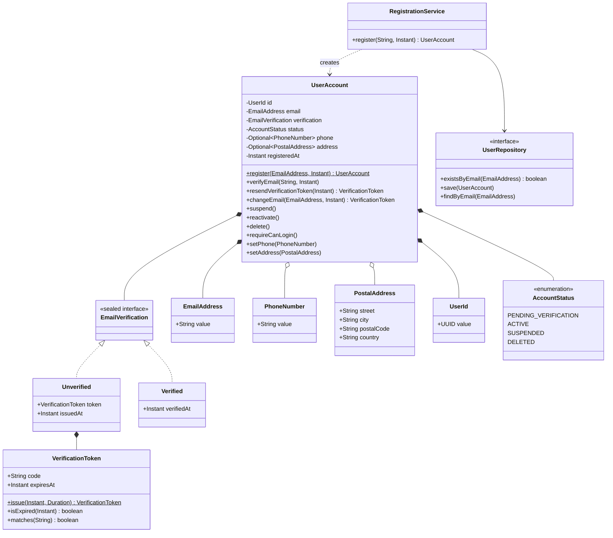
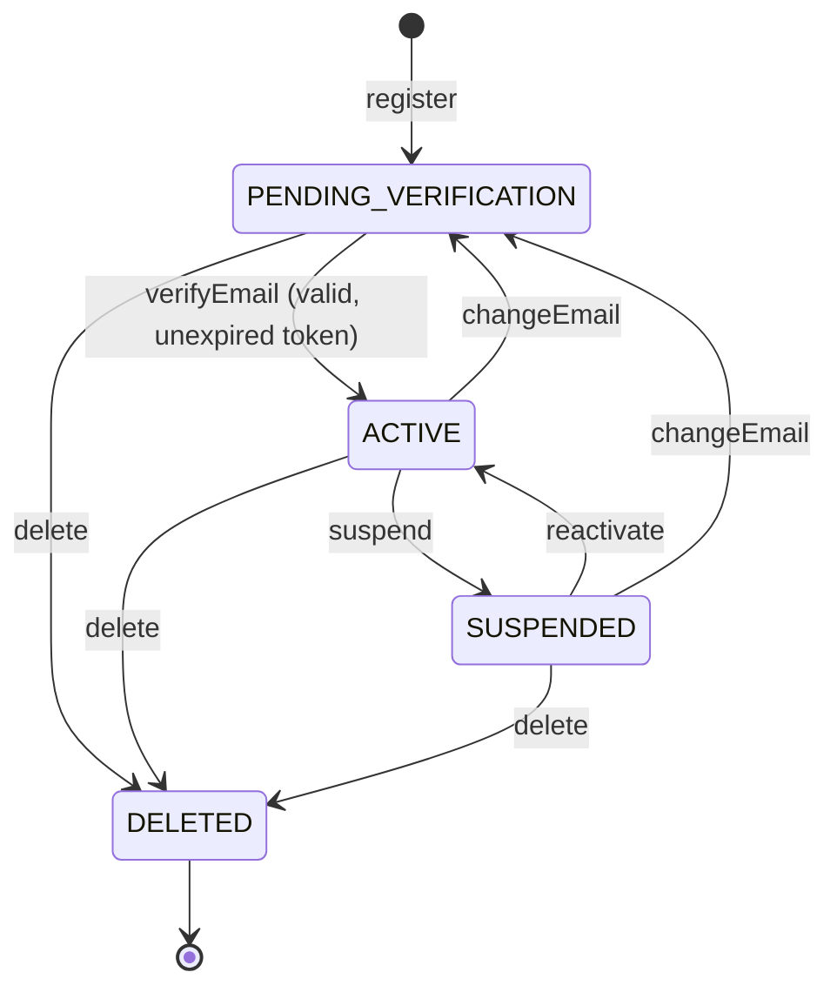

# CO-1 Case Study 5: User Accounts, Email Verification and Contact Details

**Course:** Advanced Object-Oriented Programming (25CS2205E) — CO-1 Team-Based Case Study Exercises
**Team:** Team 3
**Topic:** Domain Modeling – Self-Enforcing Objects, Entities vs Values, and Making Illegal States Unrepresentable

> **How this solution is structured:** Case Studies 1 (Money & Pricing) and 2 (Order Lifecycle) — common for all teams — follow one pattern: *Scenario → Naive Model → Problems → Invariants → Classification → Refined Model (Java) → Illegal States Eliminated → Cross-Aggregate Rules*. This solution applies exactly that pattern to Case Study 5, and maps every section to the case-study questions (Q1–Q5) and to the Common Team Submission Requirements.

---

## 1. Problem Analysis (Submission Requirement 1)

A SaaS company is building a user account management system supporting registration, email verification, optional phone numbers, postal addresses, activation, suspension and deletion.

The existing system stores a user as a flat bag of primitive, nullable fields:

```java
class User {
    public String  email;
    public boolean emailVerified;
    public Date    verifiedAt;          // nullable
    public String  verificationToken;   // nullable
    public Date    tokenExpiry;         // nullable
    public String  phone;
    public String  street, city, postalCode, country;
    public String  status;              // "ACTIVE", "SUSPENDED", ... free text
}
```

### Problems in this naive model

| # | Problem (from the case study) | Root cause in the naive model |
|---|---|---|
| 1 | Users register with incorrectly formatted emails | `email` is a raw `String`; nothing validates it |
| 2 | Users marked verified with no verification date recorded | `emailVerified` (boolean) and `verifiedAt` (nullable) are **independent** fields — they can contradict each other |
| 3 | Expired verification tokens are accepted | Token and expiry are separate loose fields; the verify operation does not check expiry as part of the token itself |
| 4 | Phone numbers stored in different formats | `phone` is a raw `String`; no canonical format exists |
| 5 | Postal addresses contain incomplete information | Address is four separate nullable strings; any subset can be filled |
| 6 | Suspended users can still log in | `status` is free text and the login path does not enforce a state rule inside the domain object |
| 7 | Duplicate accounts with the same email in different capitalisation | No normalisation: `"Tej@X.com"` and `"tej@x.com"` are different strings, and uniqueness (if checked at all) compares raw strings |

These are the same *classes* of defects as Case Study 1 (free strings for currency, unbounded numbers) and Case Study 2 (booleans + status string producing contradictory states, nullable state data that can disagree with the status). The cure is also the same: **push every rule into the types and into the object itself, so invalid objects cannot be constructed and invalid operations cannot be called successfully.**

---

## 2. Q1 — Identification of Invariants (6 Marks) (Submission Requirement 2)

An *invariant* is a business rule that must hold true at all times, for every user account, no matter what operation is performed.

| # | Invariant (business rule) | Why it must be enforced | What happens if it is violated |
|---|---|---|---|
| 1 | **Every email address stored is syntactically valid.** | Email is the account's identity anchor and the channel for verification, password reset and billing notices. | Undeliverable verification/reset mail; accounts the user can never activate or recover; garbage data spreading to every integrated service. |
| 2 | **An account is verified if and only if a verification time is recorded.** Verification state and `verifiedAt` can never disagree. | Audit, support and compliance all depend on knowing *when* ownership of the email was proven. | The reported bug itself: "verified" accounts with no proof or date — unverifiable audits, disputed account ownership, security reviews failing. |
| 3 | **A verification token is accepted only while unexpired, only if it matches, and only once.** | Tokens are credentials; expiry bounds the attack window, single-use prevents replay. | Expired/stolen tokens activate accounts long after issue; replayed tokens re-verify changed addresses; account-takeover risk. |
| 4 | **A phone number, if present, is in exactly one canonical format (E.164: `+` + country code + digits).** | SMS/OTP delivery, deduplication and display all assume one representation. | OTP messages fail for some formats; the same person appears as multiple different contacts; string comparisons and searches silently miss matches. |
| 5 | **A postal address, if present, is complete: street, city, postal code and country all present.** | Shipping, invoicing and KYC need every component; a partial address is operationally useless. | Failed deliveries, rejected invoices/KYC, support tickets — all discovered late, after the user believes the address was saved. |
| 6 | **Only an ACTIVE account may log in.** Suspended, not-yet-verified and deleted accounts are always refused. | Suspension and deletion are the company's enforcement tools (abuse, non-payment, account closure); verification proves email ownership before first use. | The reported bug: suspended users keep full access, making suspension meaningless; deleted accounts resurface; unverified accounts bypass proof of ownership. |
| 7 | **Every email address is unique across all registered users — compared in normalised (trimmed, lower-cased) form.** | Email is the login identifier and the recovery channel; it must identify exactly one account. | The reported bug: one person holds several accounts via capitalisation variants; password resets and notices go to ambiguous identities; billing/support cannot tell which account is real. |
| 8 | **Changing the email address returns the account to unverified until the NEW address is verified.** | Verification proves ownership of a *specific* address; it must not carry over to an address never proven. | A user verifies a harmless address, swaps in someone else's (or a typo'd) address, and the account claims a verified identity it never proved — breaking invariant 2 in spirit and enabling impersonation. |
| 9 | **Account lifecycle transitions follow a legal order** (see §5): no activation before verification, no reactivation of a pending account, DELETED is terminal. | Each state has legal next states only; arbitrary jumps create accounts that are simultaneously "deleted and active" in effect. | Deleted accounts logging back in, pending accounts being "reactivated" into active without verification — the same class of contradiction as Case Study 2's shipped DRAFT orders. |

---

## 3. Q2 — Entities and Value Objects (6 Marks) (Submission Requirement 3)

Classification is decided by four tests (the same tests used in Case Studies 1 and 2): **identity** (is it tracked by an ID, or by its contents?), **equality** (same ID or same value?), **lifecycle** (does it live and change independently?), **mutability** (can it change in place?).

| Concept | Classification | Justification |
|---|---|---|
| **User Account** | **Entity — aggregate root** | It has a unique identity (`UserId`) that persists while everything about it changes (email, status, contact details). Two accounts with identical email-format data are still different accounts. It has an independent lifecycle: register → verify → suspend → delete. All rules about the account are enforced through this root. |
| **User Identifier** | **Value Object** | The ID itself has no lifecycle or behaviour of its own; it is defined entirely by its value (a UUID). Wrapping it in a type (instead of a raw `UUID`/`String`) means a `UserId` can never be silently swapped with any other identifier in a method call — the same reasoning as `OrderId`/`ProductId` in Case Study 2. Immutable. |
| **Email Address** | **Value Object** | Defined entirely by its normalised string value: two `EmailAddress` objects with the same normalised value are interchangeable. No identity or lifecycle — an account does not "mutate" its email, it *replaces* it with a new `EmailAddress` value. Immutable; validity and normalisation are enforced at construction. |
| **Phone Number** | **Value Object** | Same reasoning: equality by normalised E.164 value, no identity, no lifecycle. Replaced, never edited in place. |
| **Postal Address** | **Value Object** | An address has no identity of its own — nobody tracks "address #4721" through a lifecycle; it is meaningful only as a complete set of values belonging to a user. Equality by all four components; immutable; completeness enforced at construction. |
| **Verification Token** | **Value Object** | A token is defined entirely by its contents (code + expiry instant, which are inseparable). It is never mutated: when a token expires or is resent, the old value is *replaced* by a newly issued one. It has no identity independent of the account that holds it — it exists only inside the `Unverified` verification state of that account. (Modelling note: if the business later needed an audit history of every token ever issued, tokens would be promoted to entities inside the aggregate — the current requirements do not ask for that.) |

---

## 4. Q3 — Making Illegal States Unrepresentable (8 Marks)

### 4.1 Problems with the primitive/nullable/Boolean representation

The naive `User` class (see §1) fails in five structural ways:

1. **No validation anywhere.** `String email`, `String phone`, `String status` accept *any* text — `"not-an-email"`, `"123"`, `"ACTTIVE"`. Every caller must remember to check; eventually one forgets (this is exactly Case Study 1's free-string currency).
2. **Contradictory verification state.** `emailVerified` (boolean), `verifiedAt` (nullable), `verificationToken` and `tokenExpiry` (both nullable) are four independent fields → 2⁴ combinations, most of them meaningless: verified = true with `verifiedAt = null` (the reported bug), verified = false with a date set, a live token on an already-verified account, a token whose expiry is null.
3. **Partial address.** Four loose strings make *incomplete* the default state: street filled, city null, postal code empty — the object represents a broken address perfectly happily.
4. **No canonical form.** Nothing normalises email or phone, so equality (and therefore uniqueness checks and lookups) depends on however the user happened to type the value.
5. **Unguarded state.** Public/free-text `status` plus public fields means any code anywhere can write `user.status = "ACTIVE"` for a suspended user — there is no single place where the login rule lives (compare Case Study 2: `order.status = "SHIPPED"`).

### 4.2 The improved design

**(a) Domain-specific types** — every primitive is replaced by a type that carries its rule:

| Naive field | Domain type | Rule carried by the type |
|---|---|---|
| `String email` | `EmailAddress` | Format validated + trimmed/lower-cased at construction (§6) |
| `String phone` | `PhoneNumber` | Stripped of spaces/dashes, must be E.164, at construction |
| `street, city, postalCode, country` | `PostalAddress` | All four components required non-blank at construction |
| `String verificationToken` + `Date tokenExpiry` | `VerificationToken` | Code and expiry are **one indivisible value**; `isExpired(now)`, `matches(code)` behaviour built in; issued with `SecureRandom` |
| raw UUID/`String` id | `UserId` | Type-safe identity wrapper |
| `String status` | `AccountStatus` enum | Closed set: `PENDING_VERIFICATION, ACTIVE, SUSPENDED, DELETED` |

**(b) Validation rules** live in the factories/constructors of those types (see §6) — an invalid value throws `DomainException` *at the moment it is created*, so no invalid value can ever reach the account.

**(c) Verification state — one type per state** (the Model B idea from Case Study 2). The boolean + two nullable dates are replaced by a sealed type:

```java
public sealed interface EmailVerification
        permits EmailVerification.Unverified, EmailVerification.Verified {

    record Unverified(VerificationToken token, Instant issuedAt) implements EmailVerification {}
    record Verified(Instant verifiedAt) implements EmailVerification {}
}
```

- An `Unverified` account **has no `verifiedAt` field at all** — "unverified but with a verification date" cannot be expressed.
- A `Verified` account **must** supply `verifiedAt` to its constructor and **has no token field** — "verified with no date recorded" (the reported bug) and "verified account still holding a live token" are both impossible to build.
- Verification is a *replacement* of the state value: `Unverified(token) → Verified(now)`. The token ceases to exist, so it cannot be replayed.

**(d) Optional contact information** — optionality is expressed once, at the account level, with `Optional`:

```java
private Optional<PhoneNumber> phone;      // complete number, or empty
private Optional<PostalAddress> address;  // complete address, or empty
```

There is no representation for "half a phone number" or "an address with only a street": either the complete validated value object is present, or there is nothing.

**(e) The account itself is self-enforcing** — all fields private, no setters, changes only through guarded methods (`verifyEmail`, `suspend`, `reactivate`, `changeEmail`, `delete`, `requireCanLogin`). Full code in §6 and in the accompanying `src/casestudy5/` sources.

### 4.3 UML class diagram



*(A rendered image of this diagram is included as `uml-class-diagram.png`.)*

---

## 5. Q4 — Email Verification and Account Lifecycle (6 Marks)

### 5.1 What is recorded at registration

When a user registers, the system stores: a generated `UserId`; the **normalised** `EmailAddress`; a password **hash** (never the plain password — handled by the authentication layer, outside this domain model); an `Unverified` verification state containing a freshly issued `VerificationToken` (cryptographically random code, expiry = now + 24 hours); `status = PENDING_VERIFICATION`; and `registeredAt` (registration timestamp). No verified data of any kind exists at this point — by construction.

### 5.2 Token generation and validation

- **Generation:** `VerificationToken.issue(now, validity)` draws 24 bytes from `SecureRandom` and Base64-URL-encodes them. Tokens are unguessable, single-purpose, and exactly one token is live per account at any time (issuing a new one replaces the old).
- **Validation** (in `UserAccount.verifyEmail`): the account must currently be `Unverified`; the candidate must `matches()` the stored code; and `isExpired(now)` must be false. All three checks happen *inside* the aggregate, in one place. On success the state is replaced by `Verified(now)` and the account becomes `ACTIVE`.

### 5.3 Expired tokens

An expired token is rejected with a specific error ("Verification token has expired — request a new one"). The user requests a resend; `resendVerificationToken` issues a **new** token (invalidating the old one, since the old value is discarded) and the verification clock restarts. Expired tokens are never silently extended — extending would break invariant 3.

### 5.4 A verified user changes their email address

`changeEmail(newEmail, now)` performs three things atomically: (1) the application service first re-checks the **uniqueness** of the new address (see §6/Q5); (2) the account's email is replaced; (3) verification is **reset** — a fresh `Unverified` state with a new token, and the status returns to `PENDING_VERIFICATION`, so the account cannot log in until the *new* address is verified. Verification never carries across addresses (invariant 8).

### 5.5 Preventing suspended/deleted logins

Login is guarded by one domain rule, `UserAccount.requireCanLogin()`: it passes **only** when `status == ACTIVE`. The authentication flow must call it before issuing any session, so:

- `SUSPENDED` → refused (suspension takes effect immediately and cannot be bypassed by a stale screen or a direct API call),
- `PENDING_VERIFICATION` → refused (email not yet proven),
- `DELETED` → refused, and `DELETED` is terminal — no method transitions out of it.

### 5.6 Preventing contradictory verification states

By construction (see §4.2c): verification state is a single sealed value, not three independent fields. There is no boolean to disagree with the timestamp, no token that can outlive verification, and the `Verified` state cannot be instantiated without its timestamp. Lifecycle transitions are guarded methods on the aggregate (Model A pattern from Case Study 2), so illegal jumps (e.g. reactivating a pending account) throw `DomainException`.

**Lifecycle (state diagram):**



---

## 6. Q5 — Cross-Aggregate Rules and Design Evaluation (4 Marks)

### 6.1 Is email uniqueness an invariant of an individual User object?

**No.** An invariant *of an object* must be checkable using only that object's own state. Whether `tej@x.com` is unique depends on **every other account in the system** — a single `UserAccount` cannot see them. This is the same category as Case Study 2's "do not place an order if stock is insufficient": stock belongs to the Inventory aggregate, so the rule could not live inside `Order`. Uniqueness is a **set-based, cross-aggregate invariant** and must be enforced *around* the aggregate, not inside it.

### 6.2 How the application enforces it

Through `RegistrationService`, which coordinates the check across the repository:

```java
public UserAccount register(String rawEmail, Instant now) {
    EmailAddress email = EmailAddress.of(rawEmail);       // validate + normalise FIRST
    if (repository.existsByEmail(email)) {                 // cross-aggregate check
        throw new DomainException("Email already registered: " + email);
    }
    UserAccount account = UserAccount.register(email, now);
    repository.save(account);
    return account;
}
```

Because normalisation happens inside `EmailAddress`, the uniqueness check is automatically capitalisation-insensitive — the reported duplicate bug (invariant 7) is closed at this layer too.

### 6.3 The race condition

Two users registering with the same email at the same moment can **both** pass the `existsByEmail` check before either has saved (a classic check-then-act / TOCTOU race). The service-level check reduces the window for *sequential* duplicates to zero but cannot, by itself, close the *concurrent* case.

### 6.4 Database-level protection

The final line of defence is a **UNIQUE constraint (unique index) on the normalised email column** in the users table:

```sql
ALTER TABLE users ADD CONSTRAINT uq_users_email UNIQUE (email_normalised);
```

With the constraint in place, the losing transaction's insert/update fails at the database — which is the only component that truly serialises concurrent writes. The application catches that constraint violation and translates it into the same user-facing "email already registered" error. Defence in depth: domain type (normalisation) + service check (fast, friendly errors) + database constraint (correct under concurrency).

### 6.5 Strongly typed verification model — advantage and disadvantage

- **Advantage:** contradictory states are *unrepresentable, not merely checked for*. With booleans and nullable fields, correctness depends on every programmer, in every code path, forever, remembering to keep three fields consistent; with the sealed `EmailVerification` type the compiler rejects the inconsistent shapes outright, and `verifiedAt` is guaranteed present exactly when — and only when — the account is verified. Whole categories of bug (including two of the seven problems in this case study) are deleted, not managed.
- **Disadvantage:** it costs more code and complicates persistence. Two state types (plus the status enum and its transitions) are more classes than three columns; storing the sealed type in a relational database needs a state discriminator column and mapping logic, and changing the verification flow later (e.g. adding a `VerificationExpired` state) touches more code than adding a boolean. This is the same trade-off Case Study 2 records between its Model A and Model B.

---

## 7. Java Implementation (Submission Requirement 5)

Complete, compilable sources are in `src/casestudy5/` (JDK 17+; developed and run on JDK 21):

| File | Contents |
|---|---|
| `EmailAddress.java` | Value object — format validation + normalisation |
| `PhoneNumber.java` | Value object — canonical E.164 normalisation |
| `PostalAddress.java` | Value object — completeness enforced |
| `UserId.java` | Value object — type-safe identity |
| `VerificationToken.java` | Value object — code + expiry as one value; SecureRandom issue |
| `EmailVerification.java` | Sealed type-per-state: `Unverified` / `Verified` |
| `AccountStatus.java` | Lifecycle enum |
| `UserAccount.java` | Entity / aggregate root — guarded, self-enforcing operations |
| `RegistrationService.java` | Cross-aggregate uniqueness enforcement |
| `UserRepository.java`, `InMemoryUserRepository.java` | Repository abstraction + in-memory implementation |
| `DomainException.java` | Domain-rule violation exception |
| `Main.java` | Demo driver exercising every bug scenario from the problem statement |

**Build & run:**

```bash
javac -d out src/casestudy5/*.java
java -cp out casestudy5.Main
```

**Verified output (abridged):** every illegal operation is rejected — invalid email formats, duplicate registration under different capitalisation, login before verification, wrong token, expired token, token replay, phone without country code, address with a blank city, login while suspended, login after deletion, verifying a deleted account — ending with:

```
ALL DEMO CHECKS PASSED (18 checks)
```

---

## 8. Design Justification (Submission Requirement 6) — Illegal States Eliminated

| Problem in the existing system | How the proposed design eliminates it |
|---|---|
| Incorrectly formatted emails registered | `EmailAddress.of()` throws at construction; an invalid email object cannot exist, so it cannot be registered |
| Verified users with no verification date | `Verified` state *requires* `verifiedAt` as a constructor argument; the state without a date is unrepresentable |
| Expired tokens accepted | Token and expiry are one value; `verifyEmail` checks `isExpired(now)` inside the aggregate, every time |
| Phone numbers in different formats | `PhoneNumber` normalises to E.164 once, at construction; no other representation exists in the system |
| Incomplete postal addresses | `PostalAddress` refuses blank components; the account holds `Optional<PostalAddress>` — complete or absent |
| Suspended users logging in | Single guard `requireCanLogin()` passes only for `ACTIVE`; lifecycle changes go through guarded methods only |
| Duplicates via capitalisation | `EmailAddress` lower-cases at construction, making the service/repository uniqueness check capitalisation-proof; UNIQUE constraint on the normalised column is the concurrency backstop |

**Design principles demonstrated:** encapsulation (private state, no setters), value objects for all constrained data, type-per-state for verification (making illegal states unrepresentable), a guarded state machine for the account lifecycle, derived/consistent state (verification and status can never drift apart because transitions happen in exactly one method each), and honest placement of cross-aggregate rules (uniqueness in a service + database constraint, not inside the entity).
